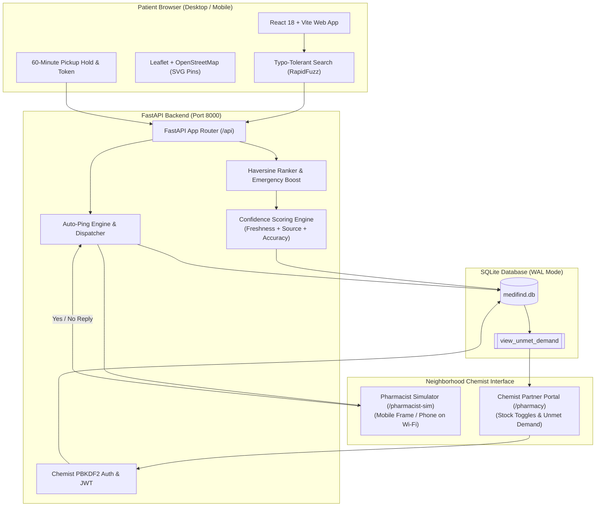

# MediFind

> *"We don't list medicines, we verify them."*

MediFind is a high-reliability, real-time medicine availability verification and 60-minute pickup reservation platform engineered for independent neighborhood pharmacies (chemists) across Indian cities.

Instead of relying on out-of-date static catalogs or centralized warehouse delivery fleets that take hours, MediFind computes a dynamic **Stock Confidence Score** ($0-100$) and dispatches real-time **Auto-Pings** directly to nearby chemists, confirming physical drawer availability before a patient steps out of their home.

---

## The Problem MediFind Solves

In Indian cities, patients and caregivers needing urgent prescription medicines (antibiotics, inhalers, pediatric suspensions, insulin) face a frustrating reality:
1. **The Physical Pharmacy Scramble**: Walking or driving from chemist to chemist only to repeatedly hear: *"Bhaiya, yeh stock abhi khatam ho gaya."*
2. **The Delivery App Failure Mode**: Centralized delivery platforms (1mg, Apollo 24/7, PharmEasy) take 2 to 48 hours and frequently cancel orders 40 minutes later due to stale centralized catalog feeds.
3. **Quick-Commerce Limitations**: Zepto and Blinkit only stock a limited selection of ~200 high-margin FMCG/OTC products, omitting critical prescription medicines.
4. **Neighborhood Chemist Neglect**: Independent community chemists hold the inventory on their shelves right now, but have zero digital presence to signal live availability to nearby patients.

---

## What Makes MediFind Different

| Capability | Legacy Catalog Aggregators | MediFind Verification Platform |
| :--- | :--- | :--- |
| **Catalog Model** | Static, unverified stock lists | Dynamic mathematical verification score |
| **Freshness Guarantee**| Days or weeks old data | 240-minute mathematical freshness decay |
| **Verification Loop** | None; discovery upon ordering | **Live 1-Tap Auto-Ping** to top 3 nearby chemists |
| **Pickup Assurance** | First-come, first-served walk-in | **60-Minute Finite Hold** with 4-digit token |
| **Chemist Incentive** | 20-30% aggregator commission | **Zero commission** + Weekly **Unmet Demand** insights |
| **Prescription Safety** | Lax digital upload loopholes | **Strict in-person Rx verification** by licensed chemist |

---

## System Architecture



---

## The Stock Confidence Score Formula

Every medicine result displays a transparent, un-bribable Confidence Score ($0-100$) calculated via:

$$\text{Score} = 100 \times \left(0.5 \times \text{Freshness} \times \text{SourceWeight} + 0.3 \times \text{Accuracy} + 0.2 \times \text{ResponseRate}\right)$$

1. **Freshness Term ($0.0 \to 1.0$)**:
   $$\text{Freshness} = \max\left(0,\, 1 - \frac{\text{minutes since confirmation}}{240}\right)$$
   *Stock data decays to zero confidence after 4 hours without verification.*

2. **Source Weight Term**:
   - `ping` (Chemist replied to live Auto-Ping): **1.0**
   - `manual` (Chemist updated toggle in portal): **0.7**
   - `csv` (Weekly inventory CSV upload): **0.5**
   - `unverified` (Initial seed / unconfirmed): **0.2**

3. **Chemist Reputation Factors**:
   - `accuracy` ($0.0 \to 1.0$): Degraded whenever customers report incorrect stock via the community flag.
   - `response_rate` ($0.0 \to 1.0$): Measured by promptness in answering incoming verification pings.

### Confidence Tier Badges
* **75 – 100%**: *"Confirmed recently"* (Deep pine green badge)
* **40 – 74%**: *"Likely available"* (Warm saffron badge)
* **Under 40%**: *"Unverified"* (Subdued gray badge with Auto-Ping prompt)

---

## Two-Device Wi-Fi Demo (Laptop + Smartphone)

MediFind supports real-time multi-device testing on the same Wi-Fi network without third-party services:

```
+---------------------------+        +---------------------------+
|      LAPTOP BROWSER       |        |     SMARTPHONE (Wi-Fi)    |
|   http://localhost:5173   |  LAN   | http://10.16.228.173:5173 |
|    (Patient App View)     | <----> | (/pharmacist-sim View)    |
+---------------------------+        +---------------------------+
```

1. Connect your Laptop and Mobile Phone to the same Wi-Fi router or phone hotspot.
2. Run `.\run.ps1` on your laptop. Note the printed IP address (e.g. `http://10.16.228.173:5173`).
3. On your phone's mobile browser, open `http://<YOUR_LAPTOP_IP>:5173/pharmacist-sim`.
4. On your laptop, open `http://localhost:5173`, search for `Augmentin` or `Calpol`, and click **"Verify Right Now (Auto-Ping)"**.
5. The incoming ping will appear on your phone within seconds. Tap **"YES, IN STOCK"**.
6. Watch your laptop card update live to **Score 99.4 ("Confirmed recently")** and move to #1 rank!

---

## One-Command Setup & Run (Windows PowerShell)

Ensure Python 3.10+ and Node.js 18+ are installed.

### Setup (Creates venv, installs deps, seeds DB)
```powershell
.\setup.ps1
```

### Run (Starts Backend on 0.0.0.0:8000 and Frontend on 0.0.0.0:5173)
```powershell
.\run.ps1
```

### Verification & Automated Tests
```powershell
# Run backend test suite (16/16 tests passing in ~2.5s)
.\backend\.venv\Scripts\pytest.exe -v backend/tests

# Run frontend production build
npm --prefix frontend run build

# Run automated end-to-end browser QA pass with multi-device screenshots
node frontend/test-qa-full.js
```

---

## Demo Credentials & Hidden Admin Reset

All 14 seeded independent pharmacies in Jaipur use the unified demo PIN:

* **Demo Store PIN**: `1234`
* **Demo Store Examples**:
  - `Central Health Chemist - C-Scheme` (Locality: C-Scheme, ID: 4)
  - `Sanjivani Chemist & 24x7 Medicos` (Locality: Tonk Road, ID: 2, Open 24x7)
  - `LifeCare 24x7 Emergency Chemist` (Locality: Ashok Nagar, ID: 5, Open 24x7)
  - `Pink City 24-Hour Medicos` (Locality: Sodala, ID: 9, Open 24x7)
  - `Sharma Medical & General Store` (Locality: Raja Park, ID: 1)
* **Hidden Demo Database Reset**:
  - Web UI: [http://localhost:5173/demo-reset](http://localhost:5173/demo-reset)
  - Admin Key: `medifind-demo-secret-2025`
  - Restores clean seed state (14 pharmacies, 74 medicines, 778 inventory rows) in **under 1.5 seconds**.

---

## Verified Multi-Device Screenshots

| Screen | Desktop View (1280px) | Mobile View (390px) |
| :--- | :--- | :--- |
| **Home Search** | [`home-desktop.png`](file:///C:/Users/muska/.gemini/antigravity/scratch/medifind/docs/screenshots/home-desktop.png) | [`home-mobile.png`](file:///C:/Users/muska/.gemini/antigravity/scratch/medifind/docs/screenshots/home-mobile.png) |
| **Results & Live Auto-Ping** | [`results-with-live-ping-desktop.png`](file:///C:/Users/muska/.gemini/antigravity/scratch/medifind/docs/screenshots/results-with-live-ping-desktop.png) | [`results-mobile.png`](file:///C:/Users/muska/.gemini/antigravity/scratch/medifind/docs/screenshots/results-mobile.png) |
| **Pharmacist Phone Simulator**| [`simulator-desktop.png`](file:///C:/Users/muska/.gemini/antigravity/scratch/medifind/docs/screenshots/simulator-desktop.png) | [`simulator-mobile.png`](file:///C:/Users/muska/.gemini/antigravity/scratch/medifind/docs/screenshots/simulator-mobile.png) |
| **60-Min Hold & 4-Digit Token**| [`reservation-desktop.png`](file:///C:/Users/muska/.gemini/antigravity/scratch/medifind/docs/screenshots/reservation-desktop.png) | [`reservation-mobile.png`](file:///C:/Users/muska/.gemini/antigravity/scratch/medifind/docs/screenshots/reservation-mobile.png) |
| **Chemist Portal & Stock Toggles**| [`portal-desktop.png`](file:///C:/Users/muska/.gemini/antigravity/scratch/medifind/docs/screenshots/portal-desktop.png) | [`portal-mobile.png`](file:///C:/Users/muska/.gemini/antigravity/scratch/medifind/docs/screenshots/portal-mobile.png) |
| **Unmet Demand Analytics Chart**| [`portal-insights-desktop.png`](file:///C:/Users/muska/.gemini/antigravity/scratch/medifind/docs/screenshots/portal-insights-desktop.png) | — |
| **How It Works Guarantee** | [`how-it-works-desktop.png`](file:///C:/Users/muska/.gemini/antigravity/scratch/medifind/docs/screenshots/how-it-works-desktop.png) | — |

---

## Free Cloud Deployment (Zero Paid APIs, No Credit Card)

MediFind is pre-configured with declarative deployment manifests for 100% free hosting tiers:

### Backend: Render Free Web Service (`render.yaml`)
1. Create a free account at [render.com](https://render.com) (no credit card required).
2. Connect your GitHub repository and select **New Web Service** using the root `render.yaml`.
3. Set environment variable `DB_PATH=/tmp/medifind.db`.
4. *Render disk is ephemeral:* MediFind's FastAPI `lifespan` handler automatically detects missing database storage on startup and seeds the database in-memory in under 2 seconds.

### Frontend: Vercel or Netlify Free Tier (`vercel.json` / `netlify.toml`)
1. Create a free account at [vercel.com](https://vercel.com) or [netlify.com](https://netlify.com).
2. Connect repository, select root directory with build command `npm run build` and publish directory `dist`.
3. Add environment variable `VITE_API_URL=https://<YOUR_RENDER_BACKEND_URL>/api`.
4. Both platforms include automatic Single-Page-App (SPA) HTML5 rewrite rules.

---

## Complete REST API Contract (Prefix: `/api`)

All endpoints return JSON. In case of errors, responses strictly follow `{"error": {"code": "...", "message": "..."}}`.

| Method | Endpoint | Description |
| :--- | :--- | :--- |
| `GET` | `/api/health` | Health check verifying SQLite database connectivity |
| `GET` | `/api/medicines/suggest?q=` | RapidFuzz typo-tolerant autocomplete (top 8 matches with salt) |
| `GET` | `/api/search?medicine_id=&lat=&lng=&radius_km=&emergency=` | Nearby pharmacies ranked by stock status, confidence, and distance |
| `POST` | `/api/search/{search_id}/ping` | Dispatches auto-ping batch to top 3 nearby pharmacies (rate limited) |
| `GET` | `/api/pings/{batch_id}/status` | Polls batch statuses (`waiting`, `yes`, `no`, `no_reply`) |
| `POST` | `/api/pings/{ping_id}/reply` | Pharmacist replies (`{"reply": "yes" \| "no"}`), live-updating inventory |
| `GET` | `/api/pings/pending` | Simulator helper returning pending pings for demo device |
| `POST` | `/api/reservations` | Requests 60-min hold reservation with 4-digit token |
| `GET` | `/api/reservations/{id}` | Fetches reservation details with automatic lazy expiry check |
| `PATCH`| `/api/reservations/{id}` | Updates reservation status (rejects illegal transitions with `409 Conflict`) |
| `GET` | `/api/pharmacies` | Chemist portal directory helper |
| `POST` | `/api/pharmacy/login` | Authenticates chemist via Store ID + PIN against salted PBKDF2 hash |
| `GET` | `/api/pharmacy/{id}/dashboard` | Chemist dashboard with pings, active holds, and inventory (JWT Bearer) |
| `PUT` | `/api/pharmacy/{id}/inventory` | Chemist updates stock status or price in real time (source='manual') |
| `POST` | `/api/reports` | Crowd-sourced wrong stock report (applies reputation accuracy penalty) |
| `GET` | `/api/insights/unmet-demand` | Weekly aggregated zero-result searches and neighborhood deficits |
| `POST` | `/api/demo/reset` | Protected demo reset endpoint restoring seed data in < 2 seconds |

---

## Honest Limitations & Future Roadmap

1. **Simulated WhatsApp Webhook**: Production deployments require Meta Business Cloud API verification ($0.01 per conversation). MediFind includes a fully functional `SimulatedPingProvider` and phone simulator so evaluators can test the complete flow without third-party messaging costs.
2. **Fictional Pharmacy Names**: All 14 pharmacies in the database are believable fictional entities modeled on real Indian community medicos to respect trademark boundaries.
3. **Local SQLite Architecture**: SQLite in WAL mode delivers instant microsecond responses locally. For horizontal scale across multiple states, migrating to PostgreSQL with PostGIS for spatial queries is the natural next step.
4. **Prescription OCR & Verification**: Future iterations will incorporate in-app doctor prescription OCR to pre-fill salt searches while preserving mandatory physical in-person verification before dispensing.

---

## Legal & Medical Disclaimer

MediFind is an information and reservation-request platform only. MediFind does not sell, deliver, or recommend medicines, and provides no medical advice or diagnostic services. All prescription medicines require verification of a valid physical or digital doctor's prescription in person by the licensed chemist before dispensing.
